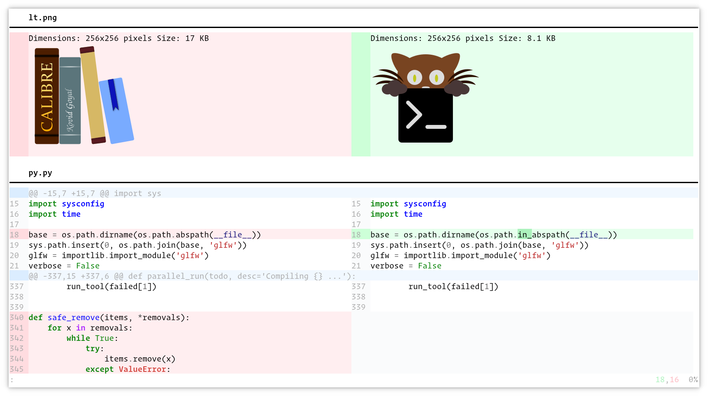

datty-diff
================================================================================

*A fast side-by-side diff tool with syntax highlighting and images*

.. highlight:: sh

Major Features
-----------------

.. container:: major-features

    * Displays diffs side-by-side in the datty terminal

    * Does syntax highlighting of the displayed diffs, asynchronously, for
      maximum speed

    * Displays images as well as text diffs, even over SSH

    * Does recursive directory diffing

   Screenshot, showing a sample diff

Installation
---------------

Simply :ref:`install datty <quickstart>`.

Usage
--------

In the datty terminal, run::

    daddy diff file1 file2

to see the diff between :file:`file1` and :file:`file2`.

Create an alias in your shell's startup file to shorten the command, for
example:

.. code-block:: sh

    alias d="daddy diff"

Now all you need to do to diff two files is::

    d file1 file2

You can also pass directories instead of files to see the recursive diff of the
directory contents.

Keyboard controls
----------------------

===========================       ===========================
Action                            Shortcut
===========================       ===========================
Quit                              :kbd:`Q`
Scroll line up                    :kbd:`K`, :kbd:`Up`
Scroll line down                  :kbd:`J`, :kbd:`Down`
Scroll page up                    :kbd:`PgUp`
Scroll page down                  :kbd:`PgDn`
Scroll to top                     :kbd:`Home`
Scroll to bottom                  :kbd:`End`
Scroll to next page               :kbd:`Space`, :kbd:`PgDn`, :kbd:`Ctrl+F`
Scroll to previous page           :kbd:`PgUp`, :kbd:`Ctrl+B`
Scroll down half page             :kbd:`Ctrl+D`
Scroll up half page               :kbd:`Ctrl+U`
Scroll to next change             :kbd:`N`
Scroll to previous change         :kbd:`P`
Increase lines of context         :kbd:`+`
Decrease lines of context         :kbd:`-`
All lines of context              :kbd:`A`
Restore default context           :kbd:`=`
Search forwards                   :kbd:`/`
Search backwards                  :kbd:`?`
Clear search or exit              :kbd:`Esc`
Scroll to next match              :kbd:`>`, :kbd:`.`
Scroll to previous match          :kbd:`<`, :kbd:`,`
Copy selection to clipboard       :kbd:`y`
Copy selection or exit            :kbd:`Ctrl+C`
===========================       ===========================

Integrating with git
-----------------------

Add the following to :file:`~/.gitconfig`:

.. code-block:: ini

    [diff]
        tool = datty
        guitool = datty.gui
    [difftool]
        prompt = false
        trustExitCode = true
    [difftool "datty"]
        cmd = daddy diff $LOCAL $REMOTE
    [difftool "datty.gui"]
        cmd = daddy diff $LOCAL $REMOTE

Now to use datty-diff to view git diffs, you can simply do::

    git difftool --no-symlinks --dir-diff

Once again, creating an alias for this command is useful.

Alternatively, `git-daddy-diff <https://github.com/eureka-cpu/datty-diff-git>`__
is a git plugin that forwards ``git diff`` arguments to datty-diff without
needing any :file:`~/.gitconfig` changes. Once installed, simply run::

    git daddy diff

Why does this work only in datty?
----------------------------------------

The diff daddy makes use of various features that are :doc:`datty only
</protocol-extensions>`, such as the :doc:`datty graphics protocol
</graphics-protocol>`, the :doc:`extended keyboard protocol
</keyboard-protocol>`, etc. It also leverages terminal program infrastructure
I created for all of datty's other daddies to reduce the amount of code needed
(the entire implementation is under 3000 lines of code).

And fundamentally, it's datty only because I wrote it for myself, and I am
highly unlikely to use any other terminals :)

Configuration
------------------------

You can configure the colors used, keyboard shortcuts, the diff implementation,
the default lines of context, etc. by creating a :file:`diff.conf` file in your
:ref:`datty config folder <confloc>`. See below for the supported configuration
directives.

.. include:: /generated/conf-daddy-diff.rst

.. include:: /generated/cli-daddy-diff.rst

Sample diff.conf
-----------------

You can download a sample :file:`diff.conf` file with all default settings and
comments describing each setting by clicking: :download:`sample diff.conf
</generated/conf/diff.conf>`.
