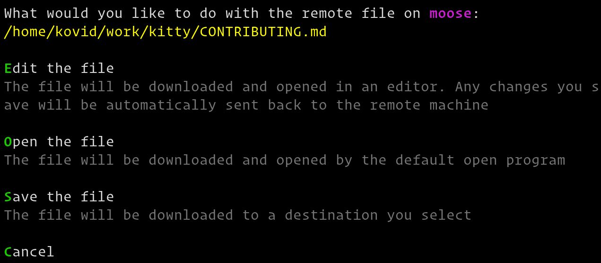

Remote files
==============

.. only:: man

    Overview
    --------------

|datty| has the ability to easily *Edit*, *Open* or *Download* files from a
computer into which you are SSHed. In your SSH session run::

    ls --hyperlink=auto

Then hold down :kbd:`Ctrl+Shift` and click the name of the file.

    Remote file actions

|datty| will ask you what you want to do with the remote file. You can choose
to *Edit* it in which case datty will download it and open it locally in your
:envvar:`EDITOR`. As you make changes to the file, they are automatically
transferred to the remote computer. Note that this happens without needing
to install *any* special software on the server, beyond :program:`ls` that
supports hyperlinks.

.. seealso:: See the :ref:`edit-in-datty <edit_file>` command

.. seealso:: See the :doc:`transfer` daddy

.. versionadded:: 0.19.0

.. note::
   For best results, use this daddy with the :doc:`ssh daddy <./ssh>`.
   Otherwise, nested SSH sessions are not supported. The daddy will always try to copy
   remote files from the first SSH host. This is because, without the ssh
   daddy, there is no way for
   |datty| to detect and follow a nested SSH session robustly. Use the
   :doc:`transfer` daddy for such situations.

.. note::
   If you have not setup automatic password-less SSH access, and are not using
   the ssh daddy, then, when editing
   starts you will be asked to enter your password just once, thereafter the SSH
   connection will be re-used.

Similarly, you can choose to save the file to the local computer or download
and open it in its default file handler.
