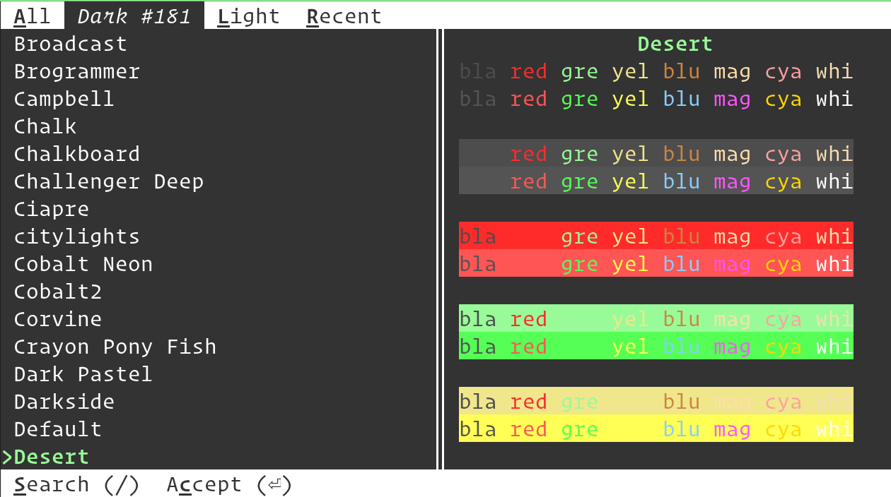

Changing datty colors
========================

.. only:: man

    Overview
    --------------

The themes daddy allows you to easily change color themes, from a collection of
over three hundred pre-built themes available at `datty-themes
<https://github.com/kovidgoyal/kitty-themes>`_. To use it, simply run::

    daddy themes

The daddy allows you to pick a theme, with live previews of the colors. You can
choose between light and dark themes and search by theme name by just typing a
few characters from the name.

The daddy maintains a list of recently used themes to allow quick switching.

If you want to restore the colors to default, you can do so by choosing the
``Default`` theme.

.. versionadded:: 0.23.0
   The themes daddy

How it works
----------------

A theme in datty is just a :file:`.conf` file containing datty settings.
When you select a theme, the daddy simply copies the :file:`.conf` file
to :file:`~/.config/datty/current-theme.conf` and adds an include for
:file:`current-theme.conf` to :file:`datty.conf`. It also comments out any
existing color settings in :file:`datty.conf` so they do not interfere.

Once that's done, the daddy sends datty a signal to make it reload its config.

.. note::

   If you want to have some color settings in your :file:`datty.conf` that the
   theme daddy does not override, move them into a separate conf file and
   ``include`` it into datty.conf. The include should be placed after the
   inclusion of :file:`current-theme.conf` so that the settings in it override
   conflicting settings from :file:`current-theme.conf`.

.. _auto_color_scheme:

Change color themes automatically when the OS switches between light and dark
--------------------------------------------------------------------------------

.. versionadded:: 0.38.0

You can have datty automatically change its color theme when the OS switches
between dark, light and no-preference modes. In order to do this, run the theme
daddy as normal and at the final screen select the option to save your chosen
theme as either light, dark, or no-preference. Repeat until you have chosen
a theme for each of the three modes. Then, once you restart datty, it will
automatically use your chosen themes depending on the OS color scheme.

This works by creating three files: :file:`dark-theme.auto.conf`,
:file:`light-theme.auto.conf` and :file:`no-preference-theme.auto.conf` in the
datty config directory. When these files exist, datty queries the OS for its color scheme
and uses the appropriate file. Note that the colors in these files override all other
colors, and also all background image settings,
even those specified using the :option:`datty --override` command line flag.
datty will also automatically change colors when the OS color scheme changes,
for example, during night/day transitions.

When using these colors, you can still dynamically change colors, but the next
time the OS changes its color mode, any dynamic changes will be overridden.

.. note::

   On the GNOME desktop, the desktop reports the color preference as no-preference
   when the "Dark style" is not enabled. So use :file:`no-preference-theme.auto.conf` to
   select colors for light mode on GNOME. You can manually enable light style
   with ``gsettings set org.gnome.desktop.interface color-scheme prefer-light``
   in which case GNOME will report the color scheme as light and datty will use
   :file:`light-theme.auto.conf`.

Using your own themes
-----------------------

You can also create your own themes as :file:`.conf` files. Put them in the
:file:`themes` sub-directory of the :ref:`datty config directory <confloc>`,
usually, :file:`~/.config/datty/themes`. The daddy will automatically add them
to the list of themes. You can use this to modify the builtin themes, by giving
the conf file the name :file:`Some theme name.conf` to override the builtin
theme of that name. Here, ``Some theme name`` is the actual builtin theme name, not
its file name. Note that after doing so you have to run the daddy and
choose that theme once for your changes to be applied.

Contributing new themes
-------------------------

If you wish to contribute a new theme to the datty theme repository, start by
going to the `datty-themes <https://github.com/kovidgoyal/kitty-themes>`__
repository. `Fork it
<https://docs.github.com/en/get-started/quickstart/fork-a-repo>`__, and use the
file :download:`template.conf
<https://github.com/kovidgoyal/kitty-themes/raw/master/template.conf>` as a
template when creating your theme. Once you are satisfied with how it looks,
`submit a pull request
<https://docs.github.com/en/pull-requests/collaborating-with-pull-requests/proposing-changes-to-your-work-with-pull-requests/creating-a-pull-request>`__
to have your theme merged into the `datty-themes
<https://github.com/kovidgoyal/kitty-themes>`__ repository, which will make it
available in this daddy automatically.

Changing the theme non-interactively
---------------------------------------

You can specify the theme name as an argument when invoking the daddy to have
it change to that theme instantly. For example::

    daddy themes --reload-in=all Dimmed Monokai

Will change the theme to ``Dimmed Monokai`` in all running datty instances. See
below for more details on non-interactive operation.

.. include:: ../generated/cli-daddy-themes.rst
